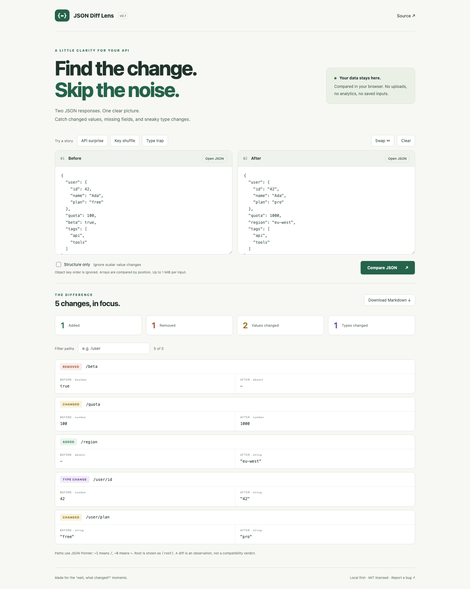

# JSON Diff Lens

**Find the change. Skip the noise.** A tiny, private workspace for comparing two JSON responses — no signup, no uploads, no build step.

[Try it live](https://boyfeiyu.github.io/json-diff-lens/) · [中文说明](#中文说明) · [Download v0.1.0](https://github.com/boyfeiyu/json-diff-lens/releases/tag/v0.1.0) · [Report a bug](https://github.com/boyfeiyu/json-diff-lens/issues)



## Why this little tool?

An API sends `42` yesterday and `"42"` today. A text diff gets distracted by shuffled object keys. You need to see the changed type, the missing field, and a short report you can attach to a bug.

- **Semantic comparison:** object key order and whitespace don't create noise.
- **Four clear signals:** added fields, removed fields, changed values, and changed types.
- **Structure only:** ignore scalar value changes while keeping field, array length, and type differences.
- **JSON Pointer paths:** filter paths such as `/user` and distinguish `/a~1b` from `/a/b`.
- **Markdown report:** download all changes, with original values and types, for a bug report.
- **Local first:** open JSON files or paste text; no network calls, web storage, analytics, backend, or production dependencies.

This is a small inspection tool, not a schema validator or patch engine. [jsondiffpatch](https://github.com/benjamine/jsondiffpatch) offers patches and smarter array matching; use it if you need those. Lens focuses on readable change cards and structure-only inspection in a standalone page. All application code here is original.

## Use it in seconds

1. Download the release ZIP and unzip it, or clone this repository.
2. Open `index.html` in a modern browser. It works with the network disabled.
3. Paste two JSON values, or choose **Open JSON**, then **Compare JSON**.
4. Try **Structure only**, filter paths, and **Download Markdown**.

No Node.js or package installation required. For a local HTTP server, optionally run:

```sh
python3 -m http.server 8080 --bind 127.0.0.1
```

Open `http://127.0.0.1:8080`; stop with Ctrl+C. Serve only the downloaded tool directory.

## A real example

Before: `{"user":{"id":42,"plan":"free"},"beta":true}`

After: `{"user":{"id":"42","plan":"pro"},"region":"eu-west"}`

| Path | Signal | Before → After |
| --- | --- | --- |
| `/beta` | Removed | `true` → absent |
| `/region` | Added | absent → `"eu-west"` |
| `/user/id` | Type changed | number `42` → string `"42"` |
| `/user/plan` | Value changed | `"free"` → `"pro"` |

Structure mode hides only the last row. It reports observed differences, not whether an API change will break a particular consumer.

## Semantics and limits

- Arrays are compared **by index**, not by ID. Reordering an array can produce many changed values. No move detection.
- A newly added/removed subtree or a type change is one card; its descendants are shown in that card.
- Structure mode inspects the actual values' shapes at each array index. It does not infer a generalized schema.
- Valid JSON only. Comments, trailing commas, YAML, and JSON Lines are not accepted. Duplicate object keys follow `JSON.parse` (last value wins).
- JavaScript numbers use IEEE 754. Unsafe integer values and non-finite results are rejected; fractional precision follows JavaScript. Encode exact decimal amounts and large numeric IDs as strings.
- Each input: maximum 1 MiB UTF-8, 50,000 nodes, 100 nesting levels. Large inputs are intentionally bounded for a responsive browser.
- The UI shows at most 300 matching cards and 8,000 characters per value preview. Filter to narrow the view; the Markdown report contains all changes and full values regardless of the filter.
- Inputs and results live in memory; refreshing loses them. Downloaded reports contain **original data and field names**, without automatic redaction. Review them before sharing.
- Requires a modern browser supporting `Object.hasOwn`, `TextEncoder`, and file downloads. Chromium is tested; other browsers have not been independently verified yet.

## Development and checks

Edit `index.html`, `style.css`, `diff.js`, or `app.js`; refresh the browser. The comparison engine also exposes a CommonJS export for reuse.

The optional browser checks require Python 3.9+ and Playwright:

```sh
python3 -m venv .venv
.venv/bin/pip install -r tests/requirements.txt
.venv/bin/python -m playwright install chromium
.venv/bin/python tests/browser_checks.py
```

On Windows, use `.venv\Scripts\python` and `.venv\Scripts\pip`. Tests start and stop their own loopback server, check comparison edge cases and UI flows, and refresh the two screenshots in `assets/`.

## 中文说明

一个可离线使用的 JSON 差异小工具。把接口修改前后的两份响应粘贴进来，就能看到新增字段、删除字段、数值变化和类型变化。对象字段换序不会产生差异；“Structure only”会忽略标量值变化，只保留字段、类型及数组长度相关变化。

下载并解压 Release，双击 `index.html` 即可使用，无需登录、安装 Node.js 或配置密钥。也可以用上面的 Python 命令在本地启动。输入不上传、不存储；导出的 Markdown **包含原始值和字段名**，分享前请自行检查。数组按位置比较，不识别按 ID 移动；结构模式不是 JSON Schema 校验。完整限制见上文。

由 boyfeiyu 发布，使用 AI 编程助手完成首版实现和验证。欢迎提交包含最小 JSON 示例、预期结果与浏览器版本的 bug；请使用虚构数据。

## License

[MIT](LICENSE) · Copyright 2026 boyfeiyu. Built with AI coding assistance, with executable checks and explicit limitations.
